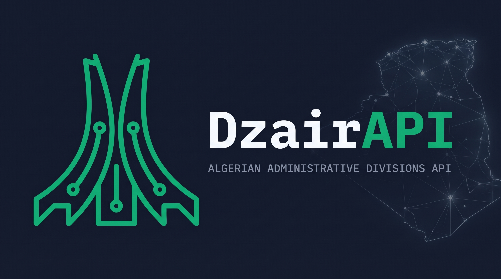

<div align="center">
  

  <h1>DzairAPI</h1>

  <p>Algerian Administrative Divisions RESTful API</p>

  <p>
    <a href="#api-overview">Swagger UI</a> &nbsp;|&nbsp;
    <a href="#api-overview">OpenAPI JSON</a> &nbsp;|&nbsp;
    <a href="#health-check">Health</a> &nbsp;|&nbsp;
    <a href="./SUPPORT.md">Support</a>
  </p>

  <p>
    
    
    
    
  </p>
</div>

---

## Quick Start

```bash
# List the first page of provinces
curl "http://localhost:8081/api/v1/provinces"

# Get a single province by its numeric code
curl "http://localhost:8081/api/v1/provinces/1"
```

DzairAPI is a read-only Spring Boot service that exposes Algerian provinces (wilayas), districts (dairas) and municipalities (communes) with localized names (Arabic, English, French), pagination, path-segment versioning (`/api/v1/...`), RFC 9457 `application/problem+json` errors, OpenAPI 3 documentation, Caffeine-based caching, and Bucket4j rate limiting.

> [!NOTE]
> Current release: **0.0.1**. A fresh clone starts with an empty database because production data is not embedded in the repository. See [Loading data](#loading-data) below.

---

## Table of Contents

- [Disclaimer](#disclaimer)
- [Environments](#environments)
- [Data](#data)
  - [Loading data](#loading-data)
- [Requirements](#requirements)
- [Installation](#installation)
- [Development](#development)
- [Build and Run](#build-and-run)
- [Tests](#tests)
- [Configuration](#configuration)
- [API Overview](#api-overview)
- [Examples](#examples)
- [Response Shape](#response-shape)
- [Query Parameters](#query-parameters)
- [Rate Limiting](#rate-limiting)
- [Health Check](#health-check)
- [Project Structure](#project-structure)
- [Additional Documentation](#additional-documentation)
- [Contributing](#contributing)
- [License](#license)

---

## Disclaimer

DzairAPI is an independent open-source project. It is not affiliated with, endorsed by, or operated by any Algerian government institution.

---

## Environments

| Environment | Base URL | Swagger UI | OpenAPI JSON |
|---|---|---|---|
| Production | TODO | TODO | TODO |
| Local (dev profile) | `http://localhost:8081` | `http://localhost:8081/swagger-ui.html` | `http://localhost:8081/openapi` |

---

## Data

> [!NOTE]
> The main Flyway migration (`V1__init_schema.sql`) contains only the schema definition. Production data is loaded separately and is not embedded in the repository. The counts below reflect the test fixtures (`src/test/resources/db/`) and may differ from production.

| Resource | Count (test fixtures) |
|---|---|
| Provinces (wilayas) | 30 |
| Districts (dairas) | 30 |
| Municipalities (communes) | 60 |

**Hierarchy:** Province → District → Municipality

**Languages available:**

| Code | Name |
|---|---|
| `ar` | العربية |
| `fr` | Français |

**Data sources:** The administrative-division data is compiled from texts published in the Official Journal of the Algerian Republic (Journal Officiel de la République Algérienne Démocratique et Populaire, JORA). This includes province (wilaya) codes, district (daïra) codes, municipality (commune) codes, and Arabic names. French and English names are translations or transliterations derived from the official Arabic names. URL slugs are generated by the project.

DzairAPI is an independent project, not an official publication. For legal or critical use, verify the data against the Official Journal.

**Data license:** `TODO: decide the data license`.

### Loading data

The main Flyway migration (`V1__init_schema.sql`) contains only the schema definition. Production data is loaded separately and is not embedded in the repository. `TODO: document how to load the dataset`.

---

## Requirements

| Dependency | Version |
|---|---|
| JDK | 25 (via Java toolchain) |
| PostgreSQL | 18.6 (as used in `docker-compose.yaml`) |
| Docker | Required for local PostgreSQL container |

Tests run against an H2 in-memory database — no external database or Docker is required to run the test suite.

---

## Installation

```bash
git clone https://github.com/hmzgtl16/dzairapi.git
cd dzairapi
```

---

## Development

The `dev` profile is active by default. It connects to a local PostgreSQL instance and enables Bucket4j rate limiting with a Caffeine JCache backend.

**Start the database:**

```bash
docker compose up -d
```

This starts a PostgreSQL 18 container with:

| Setting | Value |
|---|---|
| Host | `localhost:5432` |
| Database | `dzairapi_dev` |
| Username | `dzairapi_user` |
| Password | `dzairapi_password` |

**Run the application:**

```bash
./gradlew bootRun
```

The dev profile binds to port **8081** (`server.port=8081` in `application-dev.yaml`).

**Override profile or port at runtime:**

```bash
./gradlew bootRun --args='--spring.profiles.active=prod --server.port=8080'
```

---

## Build and Run

```bash
./gradlew build
java -jar build/libs/dzairapi-0.0.1.jar
```

To activate a specific profile:

```bash
java -jar build/libs/dzairapi-0.0.1.jar --spring.profiles.active=prod
```

Flyway runs automatically on startup in both `dev` and `prod` profiles.

---

## Tests

Tests use H2 in-memory and do not require a running PostgreSQL instance.

```bash
./gradlew test
```

Coverage is reported by Kover. The build enforces a minimum of **80% line coverage** and **70% branch coverage**.

---

## Configuration

### Common (`application.yaml`)

| Property | Default | Description |
|---|---|---|
| `server.port` | `8080` | Overridden to `8081` in `dev` and `test` profiles |
| `spring.profiles.default` | `dev` | Active profile when none is specified |
| `spring.mvc.apiversion.supported` | `1.0` | Supported API version |
| `spring.mvc.apiversion.use.path-segment` | `1` | Renders as `/api/v1/...` |
| `spring.data.web.pageable.default-page-size` | `20` | Default page size |
| `spring.data.web.pageable.max-page-size` | `100` | Maximum page size |
| `spring.kotlinx.serialization.json.naming-strategy` | `kebab_case` | JSON property naming |
| `spring.threads.virtual.enabled` | `true` | Virtual threads (Project Loom) |
| `springdoc.api-docs.path` | `/openapi` | OpenAPI JSON path |
| `springdoc.swagger-ui.path` | `/swagger-ui.html` | Swagger UI path |
| `management.endpoints.web.base-path` | `/` | Actuator base path |
| `management.endpoints.web.exposure.include` | `health` | Exposed actuator endpoints |
| `management.endpoint.health.show-details` | `never` | Health details visibility |

### Dev profile (`application-dev.yaml`)

| Property / Environment Variable | Value |
|---|---|
| `server.port` | `8081` |
| `spring.datasource.url` | `jdbc:postgresql://localhost:5432/dzairapi_dev` |
| `spring.datasource.username` | `dzairapi_user` |
| `spring.datasource.password` | `dzairapi_password` |
| Bucket4j debug logging | `com.giffing.bucket4j: debug` |

### Prod profile (`application-prod.yaml`)

The prod profile does not define datasource credentials. These must be supplied via environment variables or external configuration.

| Property | Value |
|---|---|
| `spring.jpa.hibernate.ddl-auto` | `validate` |
| HikariCP `maximum-pool-size` | `5` |
| HikariCP `minimum-idle` | `5` |
| Tomcat threads max | `200` |

---

## API Overview

### System

| Method | Path | Description |
|---|---|---|
| `GET` | `/health` | Health check |
| `GET` | `/openapi` | OpenAPI 3 JSON specification |
| `GET` | `/swagger-ui.html` | Swagger UI |

### Resources

All resource endpoints are prefixed with `/api/v1`.

| Method | Path | Description |
|---|---|---|
| `GET` | `/api/v1/provinces` | Paginated list of provinces |
| `GET` | `/api/v1/provinces/{code}` | Single province by numeric code |
| `GET` | `/api/v1/provinces/{code}/districts` | Paginated districts of a province |
| `GET` | `/api/v1/provinces/{code}/municipalities` | Paginated municipalities of a province |
| `GET` | `/api/v1/districts` | Paginated list of districts |
| `GET` | `/api/v1/districts/{code}` | Single district by numeric code |
| `GET` | `/api/v1/districts/{code}/municipalities` | Paginated municipalities of a district |
| `GET` | `/api/v1/municipalities` | Paginated list of municipalities |
| `GET` | `/api/v1/municipalities/{code}` | Single municipality by numeric code |

#### Public paths (no authentication required)

`/api/**`, `/openapi/**`, `/swagger-ui/**`, `/swagger-ui.html`, `/health/**`

All other paths are denied by the security filter chain. The API is stateless and does not require authentication.

---

## Examples

```bash
# 1. List provinces (default languages: ar, en, fr)
curl "http://localhost:8081/api/v1/provinces"

# 2. List provinces in French only
curl "http://localhost:8081/api/v1/provinces?lang=fr"

# 3. Get province with code 16 (Algiers)
curl "http://localhost:8081/api/v1/provinces/16"

# 4. List districts of province 16, page 2, 10 per page
curl "http://localhost:8081/api/v1/provinces/16/districts?page=1&size=10"

# 5. List all districts in Arabic
curl "http://localhost:8081/api/v1/districts?lang=ar"

# 6. Get municipality with code 1601
curl "http://localhost:8081/api/v1/municipalities/1601"
```

---

## Response Shape

### Paginated list (`GET /api/v1/provinces`)

```json
{
  "content": [
    {
      "code": "1",
      "slug": "adrar",
      "names": [
        {
          "name": "أدرار",
          "language": { "code": "ar", "name": "العربية" }
        },
        {
          "name": "Adrar",
          "language": { "code": "fr", "name": "Français" }
        }
      ],
      "stats": {
        "district-count": 9,
        "municipality-count": 28
      }
    }
  ],
  "number": 0,
  "number-of-elements": 20,
  "size": 20,
  "total-pages": 3,
  "total-elements": 58
}
```

### Single resource (`GET /api/v1/provinces/16`)

```json
{
  "code": "16",
  "slug": "alger",
  "names": [
    {
      "name": "الجزائر",
      "language": { "code": "ar", "name": "العربية" }
    },
    {
      "name": "Algiers",
      "language": { "code": "en", "name": "English" }
    },
    {
      "name": "Alger",
      "language": { "code": "fr", "name": "Français" }
    }
  ],
  "stats": {
    "district-count": 13,
    "municipality-count": 57
  }
}
```

### Municipality (`GET /api/v1/municipalities/{code}`)

```json
{
  "code": "1601",
  "slug": "alger-centre",
  "names": [
    {
      "name": "الجزائر الوسطى",
      "language": { "code": "ar", "name": "العربية" }
    }
  ]
}
```

> [!NOTE]
> `MunicipalityResponse` does not include a `stats` field. `DistrictResponse` includes `stats` with a single `municipality-count` field.

### RFC 9457 error (`404 Not Found`)

```json
{
  "type": "about:blank",
  "title": "Province not found",
  "status": 404,
  "detail": "No province exists with code 999.",
  "instance": "/api/v1/provinces/999"
}
```

### RFC 9457 error (`400 Bad Request` — type mismatch)

```json
{
  "type": "about:blank",
  "title": "Method argument type mismatch",
  "status": 400,
  "detail": "Parameter 'code' must be a valid Short.",
  "instance": "/api/v1/provinces/abc"
}
```

### RFC 9457 error (`429 Too Many Requests` — rate limit)

```json
{
  "type": "about:blank",
  "title": "Too Many Requests",
  "status": 429,
  "detail": "Rate limit exceeded."
}
```

---

## Query Parameters

### Pagination (all list endpoints)

| Parameter | Type | Default | Min | Max | Description |
|---|---|---|---|---|---|
| `page` | integer | `0` | `0` | — | Zero-based page index |
| `size` | integer | `20` | `1` | `100` | Number of items per page |

### Language selection (all endpoints)

| Parameter | Type | Default | Description |
|---|---|---|---|
| `lang` | string (repeatable) | (empty) | ISO 639 code(s). Comma-separated values in a single parameter are also accepted. When omitted, empty, or invalid, all three languages (ar, en, fr) are returned. |

**Examples:**

```
?lang=fr
?lang=ar&lang=fr
?lang=ar,fr
```

---

## Rate Limiting

Rate limiting is active in all profiles by default (configured in `application.yaml`). It is disabled only in the `test` profile.

| Setting | Value |
|---|---|
| Limit | 10 requests per 10 seconds per remote address |
| Initial capacity | 5 |
| Refill | 1 per 10 seconds |
| Refill strategy | Interval |
| Scope | Per remote IP address (`getRemoteAddr()`) |
| Cache backend | Caffeine JCache (`dzairapi-rate-limit-buckets`, in-memory) |
| Cache spec | `maximumSize=1000000,expireAfterAccess=3600s` |
| Error response | `application/problem+json`, HTTP 429 |

Buckets are held in memory per instance. They reset on restart and are not shared across multiple instances. Rate-limit response headers are sent by default (Bucket4j default behavior).

---

## Health Check

```bash
GET /health
```

**Response (`200 OK`):**

```json
{
  "status": "UP"
}
```

The health endpoint uses a custom `DatabaseHealthIndicator` that runs `SELECT 1` against the database. Details and component info are hidden (`show-details: never`, `show-components: never`).

---

## Project Structure

```txt
dzairapi/
├── .github/
│   ├── ISSUE_TEMPLATE/                   # Issue forms (bug, data, feature)
│   │   ├── bug_report.yml
│   │   ├── config.yml
│   │   ├── data_correction.yml
│   │   └── feature_request.yml
│   ├── PULL_REQUEST_TEMPLATE.md
│   └── workflows/ci.yml                  # CI: build + dependency submission
├── assets/banner.jpg
├── CODEOWNERS
├── CODE_OF_CONDUCT.md
├── CONTRIBUTING.md
├── LICENSE
├── PRIVACY.md
├── README.md
├── SECURITY.md
├── SUPPORT.md
├── SUPPORTING.md
├── TERMS.md
├── docker-compose.yaml                   # Local PostgreSQL for development
├── build.gradle.kts                      # Build configuration (Gradle, Kotlin DSL)
├── gradle/
│   └── libs.versions.toml                # Dependency version catalog
├── spotless/                             # Code-style license header templates
└── src/
    ├── main/
    │   ├── kotlin/com/example/dzairapi/
    │   │   ├── DzairAPIApplication.kt         # Spring Boot entry point
    │   │   ├── config/
    │   │   │   ├── CacheConfig.kt             # JCache (Caffeine) config
    │   │   │   ├── JpaConfig.kt               # JPA / auditing config
    │   │   │   ├── NativeHintsConfig.kt       # GraalVM native hints
    │   │   │   ├── OpenApiConfig.kt           # Springdoc OpenAPI customizers
    │   │   │   └── SecurityConfig.kt          # Spring Security filter chains
    │   │   ├── controller/
    │   │   │   ├── ProvinceController.kt      # /api/v1/provinces
    │   │   │   ├── DistrictController.kt      # /api/v1/districts
    │   │   │   └── MunicipalityController.kt  # /api/v1/municipalities
    │   │   ├── dto/                           # Request/response data classes
    │   │   ├── exception/
    │   │   │   ├── DzProvinceApiException.kt  # Sealed exception hierarchy
    │   │   │   └── GlobalExceptionHandler.kt  # RFC 9457 problem detail handler
    │   │   ├── mapping/                       # Entity-to-DTO mappers
    │   │   ├── model/                         # JPA entities
    │   │   ├── repository/                    # Spring Data JPA repositories
    │   │   ├── service/                       # Service interfaces and implementations
    │   │   └── utils/
    │   │       ├── aothint/NativeHints.kt     # AOT / native reflection hints (note: directory name is "aothint")
    │   │       ├── health/DatabaseHealthIndicator.kt
    │   │       └── openapi/Extensions.kt      # OpenAPI builder helpers
    │   └── resources/
    │       ├── application.yaml               # Base configuration
    │       ├── application-dev.yaml           # Dev profile (port 8081, local DB)
    │       ├── application-prod.yaml          # Prod profile
    │       └── db/migration/V1__init_schema.sql  # Flyway schema migration
    └── test/
        ├── kotlin/com/example/dzairapi/       # Unit and slice tests
        └── resources/
            ├── application-test.yaml          # Test profile (H2, no rate limit)
            └── db/                            # Test fixture SQL scripts
```

---

## Additional Documentation

- [Privacy Policy](./PRIVACY.md)
- [Terms of Use](./TERMS.md)
- [Security Policy](./SECURITY.md)
- [Support](./SUPPORT.md)
- [Supporting Hosting and Maintenance](./SUPPORTING.md)
- [Contributing Guide](./CONTRIBUTING.md)
- [Code of Conduct](./CODE_OF_CONDUCT.md)

---

## Contributing

See [CONTRIBUTING.md](./CONTRIBUTING.md) for details. Please also review our [Code of Conduct](./CODE_OF_CONDUCT.md). In short:

1. Fork the repository and create a feature branch.
2. Run the full build (includes tests, linting and coverage checks) before opening a pull request:

```bash
./gradlew build
```

Code style is enforced by Spotless with ktlint. The build will fail if formatting rules are violated.

For security issues, see [SECURITY.md](./SECURITY.md).

---

## License

Copyright 2026 Hamza Gattal. Source code licensed under the [Apache License, Version 2.0](./LICENSE). Data license: `TODO: decide the data license`.

See also [Terms of Use](./TERMS.md) and [Privacy Policy](./PRIVACY.md).